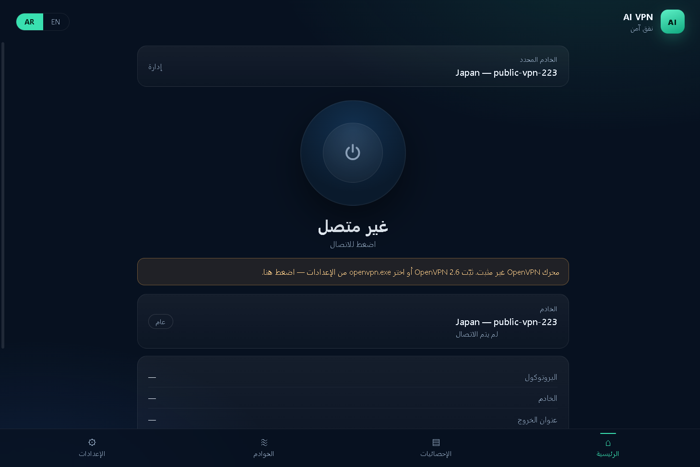

# AI VPN — نسخة Windows

تطبيق سطح مكتب مجاني (Windows 10/11 x64) يعيد بناء تجربة تطبيق AI VPN للأندرويد
بواجهة عربية/إنجليزية، مع إصلاحات جوهرية للمشاكل التي ظهرت في نسخة الهاتف.

البرنامج واجهة أمام `openvpn.exe` الرسمي، ويتصل فقط عبر ملف `.ovpn` خاص تستورده
أنت. لا حسابات، لا إعلانات، لا تتبع.



## ما الذي تحسّن مقارنة بنسخة الأندرويد

1. **بوابة إفصاح واحدة في الخلفية.** قرار الإفصاح يُفرض في العملية الرئيسية
   (main)، لا تستطيع الواجهة تجاوزه.
2. **مصدر واحد للحقيقة.** كل ما يظهر من خادم أو IP أو بروتوكول يأتي من جلسة
   الاتصال الفعلية فقط؛ لا تُعرض بيانات خادم خاص أثناء جلسة عامة.
3. **سرعة مقاسة فقط.** تُعرض نتيجة قياس حقيقية عبر Cloudflare، أو شرطة. لا
   أرقام مخزّنة أو تقديرية.
4. **IPv6 وDNS خارج النفق محجوبان صراحةً** عبر `block-ipv6` و`block-outside-dns`؛
   ويظهر إعداد IPv6 في شاشة الإحصاءات. كما يُفرَض `remote-cert-tls server`
   و`tls-version-min 1.2` في الإعداد المولَّد، وتُحذف أي نسخة منهما من الملف
   الخاص، فلا يستطيع الملف تخفيض TLS أو تعطيل التحقق من دور الخادم.
   ويُعفَّر الملف قبل وصوله إلى المحرك: تُحذف تعليمات الإضافات والسكربتات
   (`plugin` و`up` و`down` و`tls-verify` و`script-security` وغيرها)، وتُحذف
   صيغة `setenv opt <option>` كاملةً لأن OpenVPN 2.6.14 ينفّذها كخيار حقيقي
   (مثبت: `setenv opt plugin` مخفي وصل إلى `PLUGIN_INIT`؛ انظر
   [`evidence/option-injection.txt`](evidence/option-injection.txt))، ويُطبَّع
   البادئة `--` قبل المطابقة لأن المحرك يحذفها وينفّذ `--plugin` كأنها `plugin`
   (الملف نفسه). ويُثبَّت الإعداد المولَّد `script-security 1`.
5. **أسرار مشفّرة.** بيانات الدخول والملف الخاص يُخزَّنان عبر DPAPI
   (`safeStorage`)؛ لا يوجد بديل نصي صريح.
6. **لا نسخة نصية صريحة لملف الاتصال.** يُخزَّن الملف الخاص عبر DPAPI. يبقى
   `run.ovpn` المؤقت فقط أثناء محاولة الاتصال أو بقاء النفق، ثم يُحذف عند
   الفصل أو الفشل.
7. **إيقاف نظيف عند الخروج.** الخروج من أيقونة شريط النظام يفصل النفق ويحرّر
   ملفات التشغيل قبل الإغلاق. إغلاق النافذة بالزر × يخفيها إلى شريط النظام
   ويُبقي النفق قائماً (سلوك معتاد في برامج VPN)؛ للخروج الكامل استخدم قائمة
   الأيقونة ← «خروج».
8. **بيانات التشغيل قصيرة العمر.** ملف `auth.txt` يُكتب لحظة الاتصال ويُحذف
   بعد نجاحه أو بعد الفصل.

## وكيل الحماية داخل التطبيق

مكوّن دائم داخل البرنامج يراقب النفق ويعرض حكمه في الواجهة، بلا خدمة خارجية
وبلا حساب. يظهر في شاشة الإحصاءات، وعند وجود مشكلة يظهر شريط تنبيه في الشاشة
الرئيسية.

**ما يفحصه:**

1. **النفق:** عنوان IP الداخلي وواجهة المحول، مقروءين من سجل OpenVPN نفسه.
2. **المسار:** وجود مساري `0.0.0.0/1` و`128.0.0.0/1` كليهما عبر بوابة النفق؛
   غياب أحدهما يُصنَّف خطراً لأن جزءاً من الحركة قد يخرج خارج النفق.
3. **DNS:** خوادم DNS المدفوعة يجب أن تكون مسجّلة على محوّل النفق نفسه، لا على
   محوّل آخر.
4. **تسريب IPv6:** أي مسار IPv6 افتراضي عبر محوّل خارج النفق يُصنَّف تحذيراً.
5. **التشفير:** إصدار TLS والخوارزمية من سجل الجلسة؛ إن غاب دليل TLS يُعلن
   الحكم «غير معروف» بدل ادعاء السلامة.
6. **شهادة الخادم:** قبل تشغيل المحرك المرتفع الصلاحية، يدقق فحص تمهيدي
   بصلاحية المستخدم شهادة الخادم عبر `tls-export-cert` ويحسب بصمة **SHA-256**
   للشهادة الفعلية. تُمرَّر البصمة إلى النفق بـ`peer-fingerprint`، فيرفض محرك
   OpenVPN نفسه أي شهادة أخرى **قبل** إنشاء قناة البيانات. تُثبَّت البصمة لكل
   خادم عند أول اتصال ناجح (في `guard.json`)، وأي تغيّر لاحق يمنع الاتصال برسالة
   `certpin` ويُصنَّف **خطراً** ويطلق تنبيه النظام. بعد التحقق من أن التغيير شرعي،
   يعيد زر «إعادة تثبيت الشهادة الحالية» في الإعدادات تسجيل البصمة الجديدة؛ لا
   يوجد تثبيت تلقائي عند التغيّر. وملف الخادم الواحد يفشل مغلقاً: إذا لم يُنتج
   الفحص التمهيدي بصمة ولم تكن هناك بصمة محفوظة يُرفض الاتصال بالخطأ
   `certUnavailable` بدل فتح نفق غير مثبَّت. أما الملفات ذات عدة `remote` أو كتل
   `<connection>` فلا تكفيها بصمة واحدة، لذا تتصل بالتحقق من سلسلة CA وتُعرض
   الشهادة على أنها غير متحقَّق منها؛ ولا تُخزَّن سلسلة التحقق كبصمة أبداً.
   وإذا كان اسم الخادم الواحد موزّعاً على عقد بشهادات مختلفة فالربط يفشل مغلقاً
   (لا يُفتح النفق) حتى تعيد التثبيت بعد التأكد.
   الدليل الحقيقي (خادم محلي، محرك 2.6.14): [`evidence/fingerprint-loopback.txt`](evidence/fingerprint-loopback.txt).
7. **سلامة التشغيل المرتفع:** لا يُنفَّذ أي ملف يملكه حسابك بصلاحية مسؤول.
   أمر الإطلاق يُمرَّر مضمّناً في سطر أوامر ثابت (`-EncodedCommand`)، فلا يمكن
   استبداله بعد إنشائه. وبعد موافقة UAC ينسخ الجزء المرتفع إعداد النفق إلى
   مجلد `C:\ProgramData\AIVPN` مقيّد على Administrators وSYSTEM، ويتحقق من
   بصمة SHA-256 المحسوبة قبل طلب الصلاحية؛ لا يبدأ المحرك إلا إذا طابقت.
   أي استبدال بين كتابة الإعداد ومنح الصلاحية يُلغي التشغيل برسالة `TAMPERED`
   ولا يُفتح نفق. سكربت استرداد Kill Switch يُعاد بناؤه في الذاكرة بدل الثقة
   بملف على القرص.
   ويبقى الجزء المرتفع نفسه مشرفاً على المحرك طوال الجلسة: يقرأ نبضة من
   `engine.heartbeat` في مجلد التشغيل، ويوقف المحرك عند كتابة `engine.stop`
   (فصل أو فشل) أو عند توقف النبضة (انهيار الواجهة)، ثم يزيل المسارات التي
   أضافها النفق ويمسح مجلد التشغيل المرتفع. لا يُطلب UAC ثانٍ، لأن الإيقاف
   ينفّذه المشرف الذي يملك صلاحيات المسؤول أصلاً. ملفات النبضة والإيقاف يقرؤها
   حسابك نفسه، وهذا لا يفتح صلاحية جديدة: أي عملية تعمل بحسابك تستطيع أصلاً
   إغلاق الواجهة أو الكتابة مكان الإعداد قبل منح الصلاحية.
8. **مقبس الإدارة المحلي:** لا تُرسل كلمة مرور الإدارة ولا تُقبل حالة نفق إلا
   إذا كان مالك اتصال `127.0.0.1` هو عملية المحرك التي أطلقها التطبيق: يُطابَق
   PID من جدول TCP مع `engine.pid`، ويُطابَق مسار الملف التنفيذي عبر WMI مع
   مسار `openvpn.exe`. عملية أخرى تحجز المنفذ العشوائي أولاً لا تتلقى السر
   ولا تستطيع تزوير حالة «متصل»؛ يُسجَّل السبب في `detail` ويُعاد الانتظار.
   الدليل الحقيقي: [`evidence/management-peer.txt`](evidence/management-peer.txt).
9. **محرك OpenVPN:** التحقق من توقيع Authenticode لملف `openvpn.exe` ومن أن
   الموقّع هو OpenVPN Inc. وهذا يُفرَض قبل التشغيل أيضاً: بالخيار الافتراضي
   «ارفض الاتصال» يمنع التطبيق الاتصال عند توقيع غير صالح أو ناشر آخر
   (ENGINE_UNTRUSTED) بدل الاكتفاء بتحذير. ويُشترط أيضاً ألا يكون مجلد المحرك
   قابلاً للكتابة لحسابك (ENGINE_DIR_UNSAFE)، لأن OpenVPN يحمّل مكتبة محول
   الشبكة من مجلده، فزرع مكتبة بجانب `openvpn.exe` موقّع تماماً يتجاوز فحص
   التوقيع (دليل حقيقي: نسخة مطابقة بايتياً في مجلد مؤقت تنجح في فحص التوقيع
   وتُرفض مع ذلك — [`evidence/engine-path.txt`](evidence/engine-path.txt)).
   ولا يتغيّر مسار المحرك إلا من منتقي الملفات الأصلي لا من تعديل إعدادات،
   والبناء المخصص غير الموقّع يحتاج فوق ذلك اختياره في الجلسة الحالية مع
   إيقاف الوضع الصارم (ENGINE_PICK_REQUIRED).
10. **Kill Switch (عند تفعيله):** يُفعَّل **قبل** بدء تشغيل المحرك المرتفع لا بعد
   قيام النفق، ففترة الاتصال ليست ثغرة تسريب. ويُرفض الملف إذا لم يكن `remote`
   عنوان IPv4 صريحاً أو اسم خادم يمكن حله بشكل حتمي إلى IPv4 قبل أي طلب صلاحية
   (KILLSWITCH_TARGET_INVALID). يُحل اسم الخادم الصالح قبل تفعيل الحظر ويُكتب
   IPv4 الناتج في الإعداد المؤقت، فيرتبط المحرك واستثناء جدار الحماية بالنقطة
   نفسها؛ وتُرفض البروتوكولات التي تفرض IPv6. وأي فشل في التشغيل أو الاتصال
   يعطّل الحظر ويعيد الشبكة. ولا يكتفي التطبيق بافتراض أن جدار الحماية يعمل؛ يقرأ من
   Windows حالة ملفات تعريف الجدار وقواعد السماح الخاصة به. أي ملف تعريف
   خروجه غير محظور يُصنَّف خطراً، وغياب قواعد السماح يُصنَّف تحذيراً، وتُعرض
   الحالة في تقرير الإحصاءات.
11. **سطح واجهة مغلق:** الواجهة معزولة (sandbox وcontextIsolation بلا Node)،
   وتعرض البيانات نصاً فقط (بلا حقن HTML)، وتحمل CSP صارماً
   (`script-src 'self'` و`connect-src 'none'` و
   `object-src`/`base-uri`/`form-action`/`frame-ancestors 'none'`). وترفض
   النافذة الانتقال إلى صفحات أخرى والنوافذ المنبثقة وإرفاق webview، فلا
   يجد أي محتوى محقون طريقاً لتحميل كود أو الوصول إلى الشبكة.

**التوقيت:** فحص تلقائي بعد 4 ثوانٍ من الاتصال ثم كل 60 ثانية، وفحص خامل عند
عدم الاتصال، وزر «فحص الآن» في شاشة الإحصاءات.

**مستويات الحكم:** سليم، تحذير، حرج، غير معروف، خامل. كل حكم مصحوب بدليل
مستخرج من السجل أو من نظام Windows؛ لا توجد درجات تقديرية.

**إشعار النظام:** عند أول انتقال إلى مستوى «خطر» يظهر إشعار من شريط النظام
(بالون)، والنقر عليه يفتح التطبيق مباشرة على شاشة الإحصاءات عند تقرير الفحص.
لا يتكرر الإشعار كل 60 ثانية ما دام الخطر قائماً؛ يتجدد فقط بعد عودة الحالة إلى
طبيعتها ثم حدوث خطر جديد. يعتمد ظهوره على تفعيل إشعارات Windows؛ إن كانت
معطّلة في الجهاز يبقى التنبيه ظاهراً داخل الواجهة فقط.

**المراقبة النبضية والاستجابة للخطر:** أثناء الاتصال يعيد وكيل الحماية فحوصه
المحلية كل 15 ثانية، إضافةً إلى فحص قصير بعد الاتصال. عند أول حكم خطر يظهر
تنبيه حماية ويُفصل VPN فصلاً عادياً. هذا المسار يوقف المحرك، ويزيل قواعد
Kill Switch، ويعيد الشبكة إلى وضعها الطبيعي؛ ويبقى التنبيه والتقرير ظاهرين
كي يراجع المستخدم السبب. لا يترك التطبيق الشبكة محجوبة بعد إيقاف النفق.

**مؤشر أيقونة النظام:** عند مستوى تحذير أو خطر يتغيّر تلميح الأيقونة وتظهر في
قائمتها حالة الحماية، والنقر عليها يفتح تقرير الفحص.

## Kill Switch الصارم

عند تفعيل Kill Switch يضيف التطبيق قاعدة حظر خروج افتراضية لكل ملفات تعريف
جدار الحماية، ويسمح بالخروج فقط لمحرك OpenVPN نحو عنوان الخادم، ولمحوّل النفق،
ولكل واجهة نفق ظاهرة بالاسم. يصنّف Windows محوّلات DCO/TAP التابعة لـ OpenVPN
كـ Public لا RemoteAccess، لذا كانت قاعدة `InterfaceType RemoteAccess` وحدها
تُسقط كل حزم النفق في 0.2.13: الواجهة تعرض CONNECTED بينما لا يصل أي تطبيق إلى
الإنترنت. الآن يبحث المراقب عن المحوّلات التي يطابق وصفها
`OpenVPN|Wintun|TAP-Windows` ويضيف قاعدة سماح لكل اسم واجهة باسم
`AI VPN Kill Switch tunnel <name>`. المحوّل لا يظهر إلا بعد اتصال المحرك، لذلك
تُفحص القائمة كل نصف ثانية، وتُتخطى الأسماء التي تحوي محارف بدل (`* ? [ ]`) حتى
لا تتوسع القاعدة إلى كل المحوّلات. المراقب يعمل بصلاحيات مسؤول في عملية منفصلة
ويكتب نبضة كل ثانية، ويكتب نسخة احتياطية من إعدادات الملفات قبل الحظر.

قبل تشغيل المحرك ينتظر التطبيق ملف `killswitch.ready.json` يحمل nonce المحاولة
الحالية. لا يكتبه المراقب المرتفع إلا بعد قراءة القواعد من مخزن جدار الحماية
والتحقق منها: كل ملف تعريف يجب أن يعيد `DefaultOutboundAction=Block`، وقاعدة
النقل يجب أن تحمل البرنامج والعنوان البعيد والبروتوكول والمنفذ المتوقعة مع
Outbound/Allow/Enabled. إن فشل التحقق استعاد المراقب الإعدادات السابقة وكتب
مؤشر فشل، وألغى التطبيق الاتصال بالخطأ `KILLSWITCH_NOT_READY`؛ ولا تُعرض حالة
`killSwitchActive` قبل هذا التأكيد. الانتظار محدود بعشرين ثانية، ومهلة الانتظار
تُبقي القفل قائماً كي تطلب المحاولة التالية الاسترداد بدل تكديس حظر ثانٍ.

- **إيقاف طبيعي أو فصل:** تُزال كل قواعد `AI VPN Kill Switch *` (بما فيها قواعد
  النفق لكل واجهة) وتُستعاد إعدادات الملفات السابقة من النسخة الاحتياطية.
- **انهيار التطبيق (الوضع الصارم، الافتراضي):** يبقى الحظر قائماً بعد توقف
  النبضة، فلا يتسرّب أي ترافيك. يمنح المراقب مهلة 60 ثانية لعودة النبضة (تعليق
  الجهاز أو بطء مؤقت) قبل إعلان الانهيار. عندها يُكتب مؤشر قفل
  `killswitch.lock.json`، وعند تشغيل التطبيق التالي تُستعاد الشبكة بطلب
  صلاحيات واحد. زر «استعادة الشبكة» في الإعدادات يفعل الشيء نفسه يدوياً.
- **بدون الوضع الصارم:** تُستعاد إعدادات الجدار بعد 5 ثوانٍ من توقف النبضة
  (يُبقي الاتصال ممكناً لكنه يفتح الشبكة عند الانهيار).
- **الاسترداد دون التطبيق:** يُعاد بناء سكربت الاسترداد في الذاكرة ويُرسل
  مباشرةً إلى المساعد المرتفع، فلا يُكتب أي سكربت استرداد في مجلد `run` القابل
  للكتابة بحساب المستخدم حتى لا يمكن استبداله لاحقاً ليعمل بصلاحيات مسؤول. إن
  تعذّر تشغيل التطبيق فاستعد الإعدادات الافتراضية من جدار حماية Windows
  Defender، أو احذف قواعد `AI VPN Kill Switch *` وأعد الإجراء الافتراضي
  للاتجاه الصادر من PowerShell بصلاحيات مسؤول.
- إن كان الحظر قائماً من جلسة سابقة يرفض التطبيق الاتصال بالخطأ
  `KILLSWITCH_LOCKED` حتى تُستعاد الشبكة.

حدود صريحة: الاسترداد يحتاج صلاحيات مسؤول (UAC)؛ إن رفضتها تبقى الشبكة مقفلة
وهذا مقصود. النسخة الاحتياطية في المجلد نفسه؛ إن فُقدت لا يُعاد الضبط إلا إذا
كانت ملفات التعريف الثلاثة كلها محظورة فعلاً، وإلا تُترك كما هي بدل تخمين إعداد
سابق. في 2026-11-14 اختُبرت النسخة المُصلحة حياً مرة واحدة على مرحّل ستوكهولم
والحظر فعّال: أعادت Google وYouTube وX الحالة HTTP 200 من تطبيق عادي، وتغيّر
عنوان الخروج من `185.158.23.164` إلى `16.171.36.113`، وبعد الفصل اختفت القواعد
وعادت إعدادات ملفات التعريف وعاد عنوان الخروج إلى `185.158.23.164`. الدليل:
[`evidence/killswitch-tunnel.txt`](evidence/killswitch-tunnel.txt). تشغيل واحد
فقط؛ لا ادّعاء استقرار لساعات. وفي تشغيل قصير منفصل جُرّب موقعان مستقلان
مذكوران في تقرير Freedom House كموقعين محجوبين في العراق: Ultra Iraq كان
محجوباً على مستوى DNS قبل الاتصال وحُلّ اسمه عبر النفق، لكن CDN الموقع أعاد
403 لعنوان المرحّل؛ وAl-Hudood عُرض في Chrome (وكان متاحاً على هذا الخط حتى
بدون النفق). أي أن النفق يتجاوز الحجب المحلي، لكن موقعاً خلف CDN قد يرفض عنوان
مركز بيانات. مسار «انهيار فعلي ثم استرداد» مُختبَر وحدياً على نصوص
السكربتات، ولم يُنفَّذ بانهيار حقيقي على جهاز بموافقة UAC بعد.

## إشراف المحرك وإيقافه

المحرك يعمل بصلاحيات مسؤول، ولذلك لا يستطيع التطبيق العادي إيقافه بأمر
`taskkill`. منذ 0.2.14 يُطلق مع المحرك مشرف مرتفع يبقى حياً للجلسة كلها
ويقوم هو بالإنهاء:

- **إيقاف بطلب:** عند الفصل أو قبل أي محاولة جديدة يُكتب `engine.stop`،
  فيوقف المشرف المحرك ويزيل مسارات النفق ويعيد كتابة حالة `stopped` مع
  السبب (`stop` أو `retire`)، ثم ينتهي.
- **فشل الاتصال:** كتابة `engine.stop` من مسار `fail()` تجعل الفشل يعود
  على المحرك أيضاً، بلا اعتماد على صلاحية الحساب العادي.
- **انهيار الواجهة:** يتوقف تحديث النبضة، وبعد 30 ثانية بلا نبضة يوقف
  المشرف المحرك تلقائياً ويكتب السبب `heartbeat-lost`. وعند تشغيل التطبيق
  التالي يُرسل طلب إيقاف فوري للمشرف الباقي دون طلب UAC.
- **المسارات:** قبل تشغيل المحرك يأخذ المشرف لقطة للمسارات في
  `routes-before.json` داخل مجلد التشغيل المرتفع. عند الإنهاء يحذف فقط
  المسارات التي ظهرت بعد اللقطة وكانت على محوّل يطابق
  `OpenVPN|Wintun|TAP-Windows`، فلا يُحذف المسار الافتراضي ولا أي مسار
  يخص محوّلاً آخر. وإذا كانت اللقطة مفقودة أو غير قابلة للقراءة يرفض
  التنظيف الحذف بدل التخمين. المحرك القديم الذي لا مشرف له يُوقف بمسار مرتفع
  محدود يزيل فقط `0.0.0.0/1` و`128.0.0.0/1` من محوّل النفق.
- **هوية موثّقة:** يسجّل الإنهاء وقت بدء عملية المحرك لحظة الإطلاق، ولا
  يوقف العملية بالقوة إلا إذا بقي وقت البدء مطابقاً، فلا يُخطئ PID
  معاد استخدامه ويُوقف برنامجاً لا علاقة له به.
- **حالة صريحة:** يكتب المشرف `engineStopped` في ملف الحالة. إذا لم
  يستطع تأكيد موت المحرك خرج بالرمز 5 وأبقى ملفات
  `engine.pid` والحالة، وتعرض الواجهة `ENGINE_STOP_FAILED` بدل تكرار
  محاولة قتل لا يمكن أن تنجح. وإذا لم يؤكد المشرف البدء خلال 20 ثانية تظهر
  `SUPERVISOR_START_TIMEOUT` ويُكتب طلب إيقاف للمشرف المتعطّل، ولا يُعلن أن
  النفق مفتوح.

حدود صريحة: اختبار هذا المسار على المضيف يستخدم محركاً وهمياً ومشرفاً
حقيقياً (إيقاف بطلب، وانقطاع نبضة، ورفض إعداد مغيَّر). وفي 2026-11-14
شُغِّل نفق مرتفع فعلي ثم أُفشل عمداً مرة واحدة: لم يبقَ محرك حي ولا مسارات
نفق (انظر [`evidence/live-teardown.txt`](evidence/live-teardown.txt)). وفضح
الاختبار نفسه خللاً في الواجهة: حكم كلمة مرور الإدارة يصل ملتصقاً بسطر
`ENTER PASSWORD:` فكان التطبيق يعلن فشل الاتصال بينما النفق يعمل فعلاً —
أُصلح في 0.2.14 ومُغطّى باختبارات على البايتات الملتقطة نفسها. لم يُعَد
تشغيل حي ثانٍ للتحقق من المصافحة المصلحة end-to-end؛ يحتاج موافقة UAC
جديدة وقد يقطع الشبكة مؤقتاً.

**فحص ما بعد الفصل:** مرة واحدة لكل جلسة، وبعد أربع ثوانٍ من انتهاء النفق، يعيد
الوكيل قراءة المسارات وخوادم DNS وعناوين المحوّلات ويبلّغ عن أي شيء ما زال
يشير إلى النفق: مسار ناقص متبقٍّ = خطر، وبقاء خوادم DNS الخاصة بالنفق أو عنوانه
على المحوّل = تحذير. نتيجة «خطر» تُطلق إشعار النظام أيضاً، فلا يمرّ خلل في
إنهاء الجلسة دون أن تلاحظه. تأخير الأربع ثوانٍ يمنع اعتبار إزالة المحوّل
الطبيعية خللاً.

**قناة التحكم المحلية:** يتصل التطبيق بمحرك OpenVPN عبر واجهة الإدارة على
العنوان المحلي فقط. صار لكل اتصال كلمة مرور عشوائية من 48 حرفاً يقرأها المحرك
من ملف مؤقت، ويقدّمها التطبيق قبل الاشتراك بالحالة، ويُحذف الملف بعد نجاح
النفق. بهذا لا يستطيع برنامج محلي آخر إرسال أوامر مثل إيقاف النفق. صيغة حكم
كلمة المرور التقطت من المحرك الحقيقي أثناء الاختبار الحي (يصل الحكم ملتصقاً
بسطر طلب كلمة المرور)، والمصافحة الآن تطابق هذه الصيغة؛ وحالتا كلمة المرور
الخاطئة والمهلة مشمولتان باختبارات آلية على مقابس وهمية.

**تحديث الاستخبارات اليومي:** يجلب البرنامج أخبار الثغرات المتعلقة بمنظومة
OpenVPN من قاعدة NVD الرسمية وقائمة CISA للثغرات المستغَلّة فعلياً، ويخزّنها
مؤقتاً 24 ساعة ويحدّثها كل 6 ساعات، مع زر تحديث يدوي. الروابط تُفتح فقط على
مواقع NVD وCISA الرسمية.

**حدود صريحة:** الوكيل يقرأ حقائق محلية (السجل، المحول، الشهادة، التوقيع) ولا
يثبت أن مشغّل الخادم لم يعبث بالجهاز، ولا يفحص إصابة جهازك ببرمجيات خبيثة، ولا
يغني عن مضاد فيروسات. «غير معروف» تعني أن الدليل غائب، وليست «آمن».

**دليل حقيقي (Windows، OpenVPN 2.6.14، نفق خاص فعلي):** ستة فحوص نُفّذت على
جلسة حقيقية: النفق سليم (`10.8.0.2` على محول OpenVPN DCO)، المسار سليم عبر
`10.8.0.1`، DNS سليم، الشهادة مطابقة، المحرك موقّع من OpenVPN Inc.، والتشفير
«غير معروف» لأن سجل DCO لا يذكر إصدار TLS — وهذا ما عُرض فعلاً. تغيّر IP
الخروج أثناء الاختبار من `185.158.23.164` إلى `16.171.36.113`، وفُصل النفق
بعده. فحص IPv6 أُضيف بعد ذلك ويتحقق من مسار IPv6 الافتراضي؛ على جهاز الاختبار
لا يوجد مسار IPv6 افتراضي، والاختبارات الآلية تغطي حالة المسار الخارجي.

- واجهة الوكيل أثناء الاتصال: [`evidence/stats-guard-live-ar.png`](evidence/stats-guard-live-ar.png)
- بطاقة الفحص والتحديث اليومي: [`evidence/stats-guard-ar.png`](evidence/stats-guard-ar.png)
- الوكيل في النسخة المحمولة المبنية نفسها (حالة خامل + 21 ثغرة): [`evidence/packaged-guard-ar.png`](evidence/packaged-guard-ar.png)
- خيار الفصل التلقائي في الإعدادات: [`evidence/settings-guard-ar.png`](evidence/settings-guard-ar.png)
- سياسة الثقة بالمحرك في الإعدادات: [`evidence/settings-engine-strict-ar.png`](evidence/settings-engine-strict-ar.png)
- خيار Kill Switch الصارم في الإعدادات (التقاط حقيقي من الواجهة): [`evidence/settings-killswitch-strict-ar.png`](evidence/settings-killswitch-strict-ar.png)
- بطاقة شهادة الخادم وزر إعادة التثبيت: [`evidence/settings-cert-repin-ar.png`](evidence/settings-cert-repin-ar.png)
- إثبات تثبيت بصمة SHA-256 مع محرك OpenVPN 2.6.14 (مباراة ورفض): [`evidence/fingerprint-loopback.txt`](evidence/fingerprint-loopback.txt)
- إثبات التحقق من بصمة الإعداد قبل التشغيل المرتفع (مطابقة تبدأ، مخالفة ترفض): [`evidence/launch-staging.txt`](evidence/launch-staging.txt)
- إثبات التحقق من مالك مقبس الإدارة على اتصال حقيقي (مطابقة/مسار مختلف/PID غريب): [`evidence/management-peer.txt`](evidence/management-peer.txt)
- إثبات حقن الخيارات عبر `setenv opt` على OpenVPN 2.6.14 (المحرك يصل إلى تحميل الإضافة، والمنقّي يحذفها): [`evidence/option-injection.txt`](evidence/option-injection.txt)
- إثبات عرض الواجهة من المصدر تحت CSP الصارم (وضع الالتقاط بلا أصول محجوبة): [`evidence/ui-csp-home.png`](evidence/ui-csp-home.png)
- إثبات ثقة مجلد المحرك (نسخة موقّعة في مجلد قابل للكتابة تُرفض، والمحرك المثبّت يُقبل): [`evidence/engine-path.txt`](evidence/engine-path.txt)
- إثبات أن استرداد Kill Switch لا يكتب أي سكربت مرتفع في مجلد المستخدم (أمر مضمَّن فقط): [`evidence/killswitch-recovery.txt`](evidence/killswitch-recovery.txt)
- إثبات السماح بواجهة النفق في Kill Switch: التقاط حي أثناء الاتصال (محوّل DCO مصنَّف Public، قاعدة بالاسم، واستجابة HTTP 200 عبر المرحّل) واستعادة الجهاز بعد الفصل: [`evidence/killswitch-tunnel.txt`](evidence/killswitch-tunnel.txt)
- معالجة ملاحظات المراجعة الأمنية: تدوير المفتاح وحفظه خارج المشروع، وربط ذاكرة التحقق بالمسار، وقناة جاهزية Kill Switch، وفحص الشهادة الذي يفشل مغلقاً؛ وملاحظات المتابعة: حظر الملفات المستوردة، وتنظيف مجلد الفحص، وتمرير مسار المحرك المتحقق منه وإعادة تأكيده قبل التشغيل، وكشف قواعد السماح الواسعة؛ مع تحقق البناء والإصدار والحدود: [`evidence/security-review-fixes.txt`](evidence/security-review-fixes.txt)
- إثبات إشراف المحرك المرتفع: الإيقاف بطلب، وانقطاع النبضة، ورفض الإعداد المغيَّر، مع حدود ما لم يُختبر حياً: [`evidence/engine-supervisor.txt`](evidence/engine-supervisor.txt)
- إثبات نفق مرتفع حي أُفشل عمداً: المحرك والمشرف يزولان، ولا مسارات نفق بعد الإنهاء، مع اكتشاف خلل سطر `ENTER PASSWORD` الملتصق وإصلاحه: [`evidence/live-teardown.txt`](evidence/live-teardown.txt)
- النتيجة الخام للاختبار: [`evidence/guard-private-test-result.json`](evidence/guard-private-test-result.json)

## المتطلبات

- Windows 10 أو 11 (x64).
- **OpenVPN 2.6** مثبّتاً (يُنزّل من الموقع الرسمي لـ OpenVPN)، مع محول
  TAP-Windows6 أو Wintun. النسخة المختبَرة فعلياً: **2.6.14**.
- صلاحية مسؤول: كل اتصال يطلب موافقة UAC لأن إنشاء محول الشبكة يحتاجها.

البرنامج **لا يضم** ملفات OpenVPN التنفيذية؛ يستخدم التثبيت الموجود على الجهاز.
يمكنك اختيار مسار `openvpn.exe` يدوياً من الإعدادات، أو تعيين المتغير
`OPENVPN_EXE`.

## التشغيل من المصدر

```bash
npm install
npm start
```

الاختبارات والفحوص:

```bash
npm test               # 97 اختباراً: تنقية الإعدادات (حقن setenv opt وبادئة -- والملفات المستوردة وتثبيت script-security)، فرض TLS 1.2 ودور الخادم، تثبيت اسم الخادم بعد حله إلى IPv4 قبل Kill Switch، ورفض البروتوكولات التي تفرض IPv6 (udp6/tcp6) في مسار التثبيت IPv4، قواعد وكيل الحماية، تثبيت الشهادة بالبصمة مع فحص تمهيدي يفشل مغلقاً (لا بصمة محفوظة ولا بصمة جديدة يرفض ملف الخادم الواحد، ولا تُثبَّت سلسلة التحقق أبداً)، ربط ذاكرة تحقق توقيع المحرك بالمسار وحالة الملف، تمرير مسار المحرك المتحقق منه إلى الجلسة وإعادة تأكيده قبل التشغيل المرتفع، فحص الشهادة التمهيدي وتنظيف مجلده، فحص ما بعد الفصل، ثقة مجلد المحرك واختيار البناء المخصص، تحقق Kill Switch بما فيه كشف قواعد السماح الواسعة في الوضع الصارم، وضع Kill Switch الصارم (قواعد سماح لواجهة النفق، والتحقق من علامة الجاهزية، والاسترداد الآمن عند فقد النسخة الاحتياطية، والاسترداد بلا نسخة PowerShell مساعدة في ملف المستخدم)، رفض الحزمة لأي مفتاح خاص، كلمة مرور واجهة الإدارة (بما فيها الحكم الملتصق بسطر ENTER PASSWORD والحاصل عبر مقطعين)، وإشراف المحرك المرتفع (تشغيل فعلي بمحرك وهمي: بصمة مطابقة تبدأ، والمخالفة تُرفض، وطلب الإيقاف وانقطاع النبضة ينهيان المحرك، وتنظيف DNS، وإنهاء موثّق بهوية العملية، وحالة engineStopped)، وتصنيف سجل لا يخطئ سطر «المسار موجود مسبقاً» بفشل مسارات
npm run test:live     # اتصال حقيقي (يتطلب OpenVPN 2.6 وموافقة UAC)
npm run test:private  # نفق خاص حقيقي مع تقرير وكيل الحماية
```

## بناء نسخة محمولة للتوزيع

```bash
npm run package
```

الناتج: `dist/AIVPN/AIVPN.exe` مع مجلد `dist/AIVPN/README.txt`. انسخ المجلد
كاملًا أو اضغطه ZIP ووزّعه مجاناً. لا يحتاج تثبيتاً، لكنه يحتاج OpenVPN مثبّتاً.

ينشئ البناء أيضاً أرشيفاً باسم `dist/AI-VPN-Windows-<version>-portable.zip`
وملف `.sha256` مطابقاً للتحقق من السلامة.

نقاط يجب معرفتها قبل النشر العام:

- الملف غير موقّع بشهادة كود، لذا سيعرض SmartScreen تحذير «ناشر غير معروف».
  الحل الاحترافي لاحقاً: شهادة توقيع كود (OV/EV) وتوقيع الملف والـ ZIP.
- الأيقونة داخل `AIVPN.exe` تبقى أيقونة Electron إلا إذا وُقّع الملف بأداة
  تعديل موارد (مثل `rcedit`). أيقونة النافذة والصينية صحيحة.
- حجم النسخة المحمولة كبير نسبياً (~360MB) لأنه يتضمن محرك Chromium كاملاً.

## بناء مثبّت Windows

ثبّت [Inno Setup](https://jrsoftware.org/isdl.php) مرة واحدة، ثم:

```bash
npm run package:installer
```

الناتج: `dist/AI-VPN-Windows-<version>-Setup.exe`. يثبّت البرنامج ويضيف اختصاراً
في قائمة ابدأ ويعرض اختيار اختصار على سطح المكتب. لا يضم ملف `.ovpn` الخاص؛
يستورده المستخدم من الإعدادات ويبقى مشفّراً في ملف تعريفه.

لتوقيع الإصدار بعد الحصول على شهادة توقيع كود حقيقية وأدوات Windows SDK:

```powershell
.\scripts\sign-release.ps1 -CertificateThumbprint <certificate-thumbprint>
```

يوقّع السكربت الملف التنفيذي والمثبّت ويتحقق منهما بخوارزمية SHA-256 مع ختم
زمني، ويفشل عمداً دون شهادة حقيقية بدل إنتاج إصدار موقّع ذاتياً ومضلّل.

## الترخيص وحقوق إعادة التوزيع

- هذا المشروع: رخصة **MIT** (انظر [`LICENSE`](../LICENSE)).
- **OpenVPN** رخصة GPLv2، ولا يُضمَّن هنا. أنت تثبّته بنفسك من مصدره الرسمي،
  فلا تنشأ عليك التزامات توزيع إضافية. إذا قررت لاحقاً تضمين OpenVPN أو
  TAP-Windows داخل حزمتك، فيجب عليك الالتزام بـ GPLv2: إرفاق نص الترخيص
  وإتاحة المصدر المقابل.

## الخصوصية

انظر [`PRIVACY_AR.md`](PRIVACY_AR.md). باختصار: الاتصالات الشبكية هي نفق
OpenVPN إلى الخادم الخاص، وقياس سرعة عبر Cloudflare، وفحص عنوان الخروج عبر
`api.ipify.org`، وجلب تحديثات الثغرات من NVD وCISA. لا تحليلات ولا إعلانات.

## دليل تحقق تاريخي (قبل التحويل إلى الخادم الخاص في 0.2)

النتائج التالية تخص بناءً أقدم يستخدم الدليل العام، وتُحفظ كسجل تطوير فقط؛
ولا تصف إصدار الخادم الخاص 0.2.

ما يلي دليل مضيف PC حقيقي (OpenVPN 2.6.14 مثبّت رسمياً على هذا الجهاز):

- `npm test`: ‏69/69 اختباراً ناجحاً (تحليل دليل VPN Gate، إزالة التوجيهات
  الخطرة من الإعدادات، تجنب مسارات Windows الخاطئة، رفض الملفات الزائدة،
  تصنيف أخطاء المحرك).
- `npm run check:directory`:
  - جُلب الدليل الحقيقي: **97 خادماً صالحاً**، زمن الجلب 8.8 ثانية.
  - قياس وصول TCP لأفضل 8 خوادم: **336–346 ms**، وخادم واحد 1396 ms.
- **نفق حقيقي من طرف إلى طرف** (`scripts/live-tunnel-test.js`، يشغّل كود
  `src/session.js` نفسه): خادم اليابان `115.179.206.241`.
  - IP الخروج قبل الاتصال: `185.158.23.164`، وبعده: `187.15.134.131`.
  - تحقق Cloudflare من الموقع: `JP`.
  - سرعة تنزيل مقاسة: **1.69 Mbps** (نافذة 7 ثوانٍ، مصدر Cloudflare).
  - بعد الفصل: عاد IP إلى `185.158.23.164` وحُذفت المسارات.
  - النتيجة الخام: [`evidence/tunnel-result.json`](evidence/tunnel-result.json).
- أثناء هذا الاختبار ظهرت ثلاثة أعطال حقيقية أُصلحت في هذه النسخة:
  1. OpenVPN يرفض `\` المفرد في مسارات السجل و`auth-user-pass` → صار المسار
     مزدوج الشرطة كما يشترط OpenVPN.
  2. OpenVPN 2.6 يفرض TLS 1.2 افتراضياً وخوادم VPN Gate ترفضه → أُضيف
     `tls-version-min 1.0` ليُسمح بالتفاوض (الخادم الياباني اختار TLS 1.3 فعلاً).
  3. عند فشل المحاولة كان المحرّك المرتفع يبقى يعمل ويمسك السجل والمحول →
     صار يُوقف (SIGTERM ثم taskkill عند الحاجة) قبل أي محاولة جديدة، وصار
     لكل محاولة ملف سجل مستقل.
- تشغيل التطبيق والتقاط الواجهات فعلياً (Electron 45 / Chromium) في:
  [home-ar](evidence/home-ar.png)، [servers-ar](evidence/servers-ar.png)،
  [stats-ar](evidence/stats-ar.png)، [settings-ar](evidence/settings-ar.png)،
  [modal-ar](evidence/modal-ar.png)، [home-en](evidence/en-home.png).
- النسخة المحمولة المبنية من هذه الشيفرة شُغّلت فعلياً (`dist/AIVPN/AIVPN.exe`)
  وواجهتها ظهرت سليمة، وبيانات الملف التنفيذي: `ProductName=AI VPN`،
  `FileVersion=0.1.0`. التقاط من النسخة المحمولة نفسها:
  [packaged-servers](evidence/packaged-servers.png).
- سلوك إغلاق النافذة: أُرسل طلب إغلاق للنافذة (CloseMainWindow)، فبقيت
  العملية حية مع نافذة مخفية (مقبض النافذة = 0)، أي أنها انتقلت إلى شريط
  النظام كما هو مصمم.

## حدود معروفة (بصراحة)

- يجب أن يبقى الخادم الخاص وملف الاتصال صالحين ومتاحين. إذا تغيّر إعداد الخادم
  أو أُلغي الملف، استورد نسخة حديثة من مشغّل الخادم.
- لا قياس سرعة رفع، ولا عدادات لحظية؛ كل ذلك معلَّم «غير مقاس» في الواجهة.
- كل اتصال يطلب UAC (سلوك متوقع لبرنامج يستخدم محول شبكة).
- ملفات OpenVPN المبنية يدوياً أو المعدّلة غير موقّعة، لذا تمنعها سياسة المحرك
  الافتراضية؛ للاتصال بها يجب إيقاف الرفض من الإعدادات. هذا تجاوز صريح ومرئي،
  لا يحدث خفية.
- فحص التحديث يقبل ملف إصدار HTTPS فقط إذا حمل توقيع **Ed25519** صالحاً
  يتحقق بمفتاح عام مضمّن في البناء؛ ملف بلا توقيع أو بتوقيع معدَّل يُرفض
  (`UPDATE_SIGNATURE`). التنزيل والتثبيت التلقائيان يبقيان معطّلين عمداً.
- مفتاح توقيع الإصدار الخاص **ليس** داخل المشروع: يقرأه سكربت
  `npm run release:manifest` من
  `%USERPROFILE%\.aivpn-release\release-signing.key` أو من المسار المطلق في
  `AIVPN_RELEASE_KEY`، ويرفض أي مفتاح يقع داخل شجرة المصادر. وترفض حزمة
  البناء أي مجلد `keys/` أو ملف `*.key/*.pem/*.p12/*.pfx` أو كتلة
  `PRIVATE KEY` مضمّنة. بصمة المفتاح العام الحالية: `1f34a6d1cb439879`.
- أيقونة شريط النظام تبقى موجودة بعد إغلاق النافذة؛ أوقف التطبيق كاملاً من
  قائمتها لإنهاء أي نفق والتأكد من عدم بقاء عملية في الخلفية.

## بنية المشروع

```
main.js                العملية الرئيسية: نافذة، صينية، IPC، بوابة الإفصاح
preload.js             جسر آمن محدود بين الواجهة والخلفية
src/session.js         تشغيل OpenVPN، إدارة management، الحالة والأخطاء
src/certprobe.js       فحص شهادة تمهيدي بصلاحية المستخدم لبصمة SHA-256 قبل تشغيل المحرك المرتفع
src/certs.js           حساب بصمة SHA-256 وتطبيعها من PEM
src/elevate.js         إطلاق مرتفع الصلاحية بأمر مضمّن ونسخ الإعداد إلى مجلد إداري والتحقق من بصمته قبل تشغيل المحرك
src/guard.js           وكيل الحماية: فحص النفق والمسار وDNS والتشفير والشهادة والمحرك
src/intel.js           تحديثات الثغرات من NVD وCISA مع تخزين مؤقت
src/measure.js         فحص IP الخروج وقياس التنزيل
src/mgmtpeer.js        التحقق من أن مقبس الإدارة يملكه محرك نفق أطلقناه (PID والمسار)
src/enginecheck.js     رفض محرك مجلده قابل للكتابة لحسابك، ورفض البناءات المخصصة غير المختارة في الجلسة
src/profiles.js        التحقق من ملفات .ovpn وحدّ الحجم
src/store.js           إعدادات وأسرار مشفرة عبر DPAPI
src/signing.js         توقيع وتحقّق Ed25519 لملف الإصدار
src/release-key.js     المفتاح العام المضمّن للتحقق من توقيع الإصدار
renderer/              واجهة عربية/إنجليزية (HTML/CSS/JS)
scripts/               اختبارات والبناء المحمول
```
