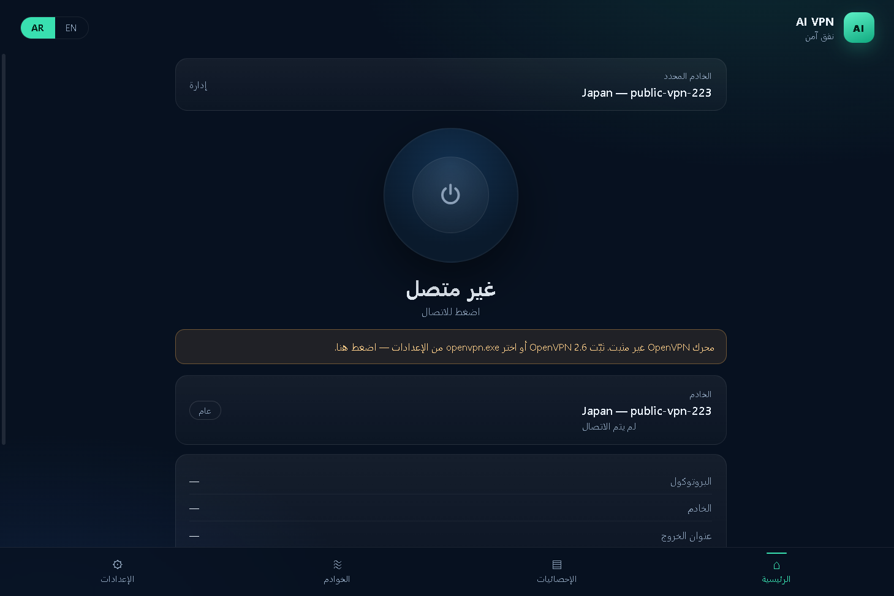

# AI VPN — Windows Edition

A free desktop app (Windows 10/11 x64) that rebuilds the AI VPN Android experience
with an Arabic/English UI and substantive fixes for the problems seen in the phone
build.

The app is a front end for the official `openvpn.exe` and connects only through an
imported private `.ovpn` profile. No accounts, no ads, no tracking.



## What improved compared to the Android version

1. **A single disclosure gate in the backend.** The consent decision is enforced in
   the main process, so the renderer cannot bypass it.
2. **One source of truth.** Every server, IP, and protocol shown comes from the live
   session only; private-server data is never shown during a public session.
3. **Measured speed only.** The UI shows a real Cloudflare measurement or a dash.
   No cached or estimated numbers.
4. **IPv6 and outside DNS explicitly blocked** inside the tunnel via `block-ipv6`
   and `block-outside-dns`; the stats screen states the IPv6 setting. The
   generated config also enforces `remote-cert-tls server` and
   `tls-version-min 1.2`, and strips any copy of either line from the private
   profile, so a profile cannot downgrade TLS or disable the server-role check.
   The profile is also sanitized before it reaches the engine: plugin/script
   directives (`plugin`, `up`, `down`, `tls-verify`, `script-security`, …) are
   removed, and the `setenv opt <option>` form is dropped entirely because
   OpenVPN 2.6.14 executes it as a real option (verified: a hidden
   `setenv opt plugin` reached `PLUGIN_INIT`; see
   [`evidence/option-injection.txt`](evidence/option-injection.txt)). A leading
   `--` is normalized before matching, because the engine strips it and would
   otherwise run `--plugin` as `plugin` (same evidence file). The generated
   config pins `script-security 1`.
5. **Encrypted secrets.** Credentials and the private profile are stored through
   DPAPI (`safeStorage`); there is no plaintext fallback.
6. **No plaintext profile cache.** The private profile is encrypted with DPAPI.
   The transient `run.ovpn` exists only while a connection attempt or tunnel is
   active, then is removed on disconnect or failure.
7. **Clean shutdown.** Quitting from the tray icon disconnects the tunnel and
   releases the runtime files before exit. Closing the window with × hides it to
   the tray and keeps the tunnel up (standard VPN behavior); use the tray menu →
   "Exit" for a full quit.
8. **Short-lived runtime data.** `auth.txt` is written at connect time and deleted
   after success or disconnect.

## In-app protection agent

A permanent component inside the app watches the tunnel and shows its verdict in
the UI, with no external service and no account. It lives on the stats screen, and
any problem raises a warning banner on the home screen.

**What it checks:**

1. **Tunnel:** the inner IP address and adapter interface, read from the OpenVPN
   session log itself.
2. **Routing:** both `0.0.0.0/1` and `128.0.0.0/1` present through the tunnel
   gateway; a missing half is critical because part of the traffic could leave
   outside the tunnel.
3. **DNS:** the pushed DNS servers must be configured on the tunnel adapter
   itself, not on another adapter.
4. **IPv6 leak:** any IPv6 default route through an adapter outside the tunnel is
   classified as a warning.
5. **Crypto:** TLS version and data cipher from the session log; if TLS evidence
   is missing the verdict is "unknown" instead of claiming safety.
6. **Server certificate:** before the elevated engine starts, a user-privilege
   preflight handshake exports the server certificate with `tls-export-cert`
   and computes its **SHA-256** fingerprint. The fingerprint is passed to the
   tunnel as `peer-fingerprint`, so the OpenVPN engine itself rejects any other
   certificate **before** the data channel exists. The fingerprint is pinned per
   server on the first successful connection (stored in `guard.json`); any later
   change blocks the connection with `certpin`, is **critical**, and raises the
   system alert. Once you confirm the change is legitimate, the "Re-pin the
   current certificate" button in Settings records the new fingerprint; there is
   no automatic re-pin on change. A single-server profile fails closed: if the
   preflight yields no fingerprint and no pin exists yet, the connection is
   refused with `certUnavailable` rather than opening an unpinned tunnel.
   Profiles with several `remote` lines or `<connection>` blocks cannot be
   covered by one fingerprint, so they connect on the CA chain and the Guard
   reports the certificate as unverified; a chain string is never stored as a
   pin. If a single server name is balanced across nodes with different
   certificates, the pin fails closed (no tunnel) until you re-pin after
   confirming. Real evidence (local server, engine 2.6.14):
   [`evidence/fingerprint-loopback.txt`](evidence/fingerprint-loopback.txt).
7. **Elevated launch integrity:** no file owned by your account is executed
   with administrator rights. The launch command is passed inline on a fixed
   command line (`-EncodedCommand`), so it cannot be swapped after spawning.
   After UAC consent the elevated part copies the tunnel config into
   `C:\ProgramData\AIVPN`, restricted to Administrators and SYSTEM, and checks
   it against the SHA-256 computed before elevation; the engine starts only if
   they match. Any swap between writing the config and granting elevation
   aborts with `TAMPERED` and no tunnel is opened. The kill switch recovery
   script is rebuilt in memory instead of trusting the file on disk.
   The elevated part also stays alive as a supervisor for the whole session:
   it watches a heartbeat in `engine.heartbeat`, stops the engine when
   `engine.stop` appears (disconnect or failure) or when the heartbeat goes
   stale (UI crash), then removes the routes the tunnel added and deletes the
   elevated staging folder. No second UAC prompt is involved, because the
   supervisor already holds administrator rights. The heartbeat and stop
   files are readable by your own account, which adds no privilege boundary:
   any process running as you can already close the UI or rewrite the config
   before elevation.
8. **Local management socket:** the management password and any tunnel state
   are accepted only if the established `127.0.0.1` socket belongs to the engine
   this app launched: the TCP owner PID is matched against `engine.pid`, and its
   executable path (WMI) against `openvpn.exe`. A process that grabs the random
   port first receives no secret and cannot forge a CONNECTED state; the reason
   is recorded in `detail` and the app keeps waiting. Live evidence:
   [`evidence/management-peer.txt`](evidence/management-peer.txt).
9. **OpenVPN engine:** Authenticode signature validation of `openvpn.exe` and
   confirmation that the signer is OpenVPN Inc. This is also enforced before
   launch: with the default "refuse to connect" setting, an invalid signature or
   a foreign publisher blocks the connection (`ENGINE_UNTRUSTED`) instead of only
   raising a warning. The engine directory must also be **not writable by your
   account** (`ENGINE_DIR_UNSAFE`), because OpenVPN loads its network-driver DLL
   from that directory and a planted DLL would sit beside a perfectly signed
   `openvpn.exe` (real evidence: a byte-identical temp copy passes the signature
   check and is still refused —
   [`evidence/engine-path.txt`](evidence/engine-path.txt)). The engine path can
   only change through the native file picker, never through a settings patch,
   and an unsigned custom build additionally requires being picked in the
   current session with strict mode off (`ENGINE_PICK_REQUIRED`).
10. **Kill switch (when enabled):** armed **before** the elevated engine starts, not
   after the tunnel is up, so the connect window is not an open leak. A profile
   whose `remote` is neither an IPv4 literal nor a hostname that resolves
   deterministically to IPv4 is refused before any elevation
   (`KILLSWITCH_TARGET_INVALID`). A valid hostname is resolved before the
   switch is armed and that IPv4 is written into the transient config, binding
   both the engine and firewall exception to the same endpoint; IPv6-forced
   protocols are refused. A launch or connect failure disarms the switch and
   restores the network. The app does not assume the firewall is doing
   its job; it reads the Windows firewall profiles and its own allow rules. Any
   profile whose outbound action is not Block is critical, missing allow rules
   are a warning, and the result appears in the stats report.
11. **Locked-down UI surface:** the renderer is sandboxed with context isolation
   and no Node integration, renders data as text only (no HTML injection), and
   carries a strict CSP (`script-src 'self'`, `connect-src 'none'`,
   `object-src`/`base-uri`/`form-action`/`frame-ancestors 'none'`). The window
   refuses navigation, pop-ups, and webview attachment, so injected content has
   no path to load code or reach the network.

**Schedule:** an automatic check 4 seconds after connecting and then every
60 seconds, an idle check while disconnected, and a "Check now" button on the
stats screen.

**Verdict levels:** ok, warning, critical, unknown, idle. Every verdict carries
evidence taken from the log or from Windows; there are no estimated scores.

**System notification:** the first crossing into "critical" raises a tray
notification, and clicking it opens the app directly on the stats screen at the
guard report. It is not repeated every 60 seconds while the fault lasts; it
re-arms only after the level recovers and a new critical fault appears. Display
depends on Windows notifications being enabled; if they are disabled on the
machine, the alert remains inside the app only.

**Pulse monitoring and critical response:** while connected, the protection
agent repeats its local checks every 15 seconds (and also checks shortly after
connecting). On the first critical verdict it shows a protection alert and
performs a normal VPN disconnect. That normal path stops the engine, removes
the Kill Switch rules, and restores the network; the alert and report remain
visible so the user can inspect the reason. It does not leave the host network
blocked after the tunnel is stopped.

## Strict kill switch

When the kill switch is enabled, the app sets a default-block outbound action on
every firewall profile and allows outbound only for: the OpenVPN engine to the
server address, the tunnel adapter, and each live tunnel interface name. Windows
classifies OpenVPN's DCO/TAP adapters as Public rather than RemoteAccess, so an
`InterfaceType RemoteAccess` allow rule alone silently dropped every tunnel
packet in 0.2.13: the UI said CONNECTED while no application could reach the
internet. The watchdog now finds adapters whose description matches
`OpenVPN|Wintun|TAP-Windows` and adds one allow rule per interface name
(`AI VPN Kill Switch tunnel <name>`). Adapters appear only after the engine
connects, so the loop re-checks every half second; names containing wildcard
characters are skipped so no rule can widen to every adapter. The watchdog runs
elevated in its own process, writes a heartbeat every second, and saves a backup
of the profile settings before blocking.

Before the engine is launched, the app waits for a `killswitch.ready.json`
marker that carries this attempt's nonce. The elevated watchdog writes it only
after reading the rules back from the firewall store: every profile must report
`DefaultOutboundAction=Block`, and the transport rule must carry the expected
program, remote address, protocol, and port with Outbound/Allow/Enabled. If a
read-back fails, the watchdog restores the previous defaults, writes a failure
marker, and the app aborts the connection with `KILLSWITCH_NOT_READY`;
`killSwitchActive` is only shown after this confirmation. The wait times out
after 20 seconds, and a timeout leaves the lock in place so the next attempt
asks for recovery instead of stacking a second block.

- **Clean stop or disconnect:** every `AI VPN Kill Switch *` rule (including the
  per-interface tunnel rules) is removed and the previous profile settings are
  restored from the backup.
- **App crash (strict mode, the default):** the block stays after the heartbeat
  stops, so no traffic leaks. The watchdog allows a 60-second grace window for
  the heartbeat to resume (system suspend or a temporary stall) before declaring
  a crash. It then leaves a `killswitch.lock.json` marker, and the next app
  launch restores the network with one elevation prompt. The "Restore network"
  button in Settings does the same manually.
- **Without strict mode:** the firewall settings are restored 5 seconds after
  the heartbeat stops (keeps reconnecting easy, but opens the network on a
  crash).
- **Recovery without the app:** the recovery script is rebuilt in memory and
  sent inline to the elevated helper, so no restore script is written to the
  user-writable `run` folder that could later be swapped into an administrator
  run. If the app cannot start, restore the defaults from Windows Defender
  Firewall (Restore defaults) or, in an administrator PowerShell, remove the
  `AI VPN Kill Switch *` rules and set the outbound default back.
- If a lock is left from a previous session, connecting fails with
  `KILLSWITCH_LOCKED` until the network is restored.

Explicit limits: recovery needs administrator rights (UAC); refusing it leaves
the network locked by design. The backup lives in the same folder; if it is
lost, profiles are only reset when all three are still Block, otherwise they are
left untouched instead of guessing the previous state. On 2026-11-14 the fixed
build was tested live once against the Stockholm relay with the block active:
Google, YouTube, and X returned HTTP 200 from a normal application, the exit IP
changed from `185.158.23.164` to `16.171.36.113`, and after disconnecting the
rules were gone, the profile defaults were restored, and the exit IP returned to
`185.158.23.164`. Evidence:
[`evidence/killswitch-tunnel.txt`](evidence/killswitch-tunnel.txt). One run only;
no multi-hour stability claim. A separate short run tried two outlets reported
blocked in Iraq: Ultra Iraq was filtered by the local resolver before connecting
and resolved through the tunnel, but its CDN returned 403 for the relay address;
Al-Hudood opened in Chrome (it was also reachable without the tunnel on this
line). So the tunnel bypasses the local block, while a site behind a CDN can
still refuse a datacenter IP. The crash-then-recovery path is unit-tested on the generated
scripts; a real crash with an approved UAC prompt has not been exercised on a
device yet.

## Engine supervisor and stop path

The engine runs elevated, so the normal user-token app cannot stop it with
`taskkill`. Since 0.2.14 an elevated supervisor is started together with the
engine and owns teardown:

- **Stop on request:** disconnect, or the start of another attempt, writes
  `engine.stop`; the supervisor stops the engine, removes tunnel routes,
  writes a `stopped` status with the reason (`stop` or `retire`), and exits.
- **Connection failure:** `fail()` writes the same stop request, so a failed
  attempt no longer leaves the engine retrying behind a failed UI.
- **UI crash:** heartbeat updates stop; after 30 seconds without a heartbeat
  the supervisor stops the engine with reason `heartbeat-lost`. The next app
  launch signals an immediate stop to a surviving supervisor without UAC.
- **Routes:** before starting the engine the supervisor snapshots routes into
  `routes-before.json` in the elevated staging folder. On teardown it deletes
  only routes that appeared after the snapshot and that sit on an adapter
  matching `OpenVPN|Wintun|TAP-Windows`; the default route and every other
  adapter are never touched. If the snapshot is missing or unreadable the
  cleanup refuses to delete anything instead of guessing. An engine from a
  build without a supervisor is stopped by a limited elevated fallback that
  removes only `0.0.0.0/1` and `128.0.0.0/1` from the tunnel adapter.
- **Verified identity:** teardown records the engine's process start time at
  launch and force-stops a PID only while that time still matches, so a
  recycled PID is never killed by mistake.
- **Explicit state:** the supervisor writes `engineStopped` into its status.
  If it could not confirm the engine died it exits with code 5 and keeps the
  pid/status markers, and the UI shows `ENGINE_STOP_FAILED` instead of
  repeating a kill attempt that cannot succeed. If the supervisor does not
  confirm startup within 20 seconds the UI shows `SUPERVISOR_START_TIMEOUT`,
  writes a stop request for the wedged supervisor, and never claims the tunnel
  is open.

Explicit limits: the host test uses a stub engine with the real supervisor
(stop request, heartbeat loss, and a swapped config). A real elevated tunnel
was connected and deliberately failed once on 2026-11-14; the supervisor left
no live engine and no tunnel routes (see
[`evidence/live-teardown.txt`](evidence/live-teardown.txt)). That same run
exposed a UI-side defect — the management password verdict arrives glued to
the `ENTER PASSWORD:` prompt, so the app had reported a failed connection
while the tunnel was actually up — which is fixed in 0.2.14 and covered by
unit tests on the exact captured bytes. A second live run to re-verify the
fixed handshake end-to-end has not been done; it needs a new UAC approval and
may interrupt the network briefly.

**Tray indicator:** on warning or critical, the tray tooltip changes and its menu
shows the protection state; clicking it opens the check report.

**After-disconnect audit:** once per session, 4 seconds after the tunnel ends, the
agent re-reads routes, DNS, and adapter addresses and reports anything still
pointing at the tunnel: a leftover split route is critical, leftover tunnel DNS or
tunnel address is a warning. A critical result also raises the system alert
(after the 4-second grace so normal adapter teardown is not flagged).

**Local control channel:** the app drives OpenVPN through its management socket on
`127.0.0.1`. Every connection now generates a random 48-character password; OpenVPN
reads it from a temporary file, the app presents it before subscribing to state,
and the file is deleted once the tunnel is up. Another local process can no longer
send commands such as `signal SIGTERM` to your tunnel. The exact verdict format
was captured from the real engine during the live run (it sends the verdict glued
to the password prompt), and the handshake now matches that form; the wrong-password
and timeout cases are covered by automated tests on stub sockets.

**Daily threat intel:** the app fetches OpenVPN-ecosystem vulnerability news from
the official NVD database and the CISA list of known exploited vulnerabilities,
caches it for 24 hours, refreshes every 6 hours, and offers a manual refresh.
Links open only on the official NVD and CISA sites.

**Explicit limits:** the agent reads local facts (log, adapter, certificate,
signature). It does not prove the server operator is honest, does not scan your
machine for malware, and is not an antivirus. "Unknown" means evidence is missing,
not "safe".

**Real evidence (Windows, OpenVPN 2.6.14, live private tunnel):** six checks ran
against a real session: tunnel ok (`10.8.0.2` on the OpenVPN DCO adapter), route
ok through `10.8.0.1`, DNS ok, certificate match, engine validly signed by OpenVPN
Inc., and crypto "unknown" because the DCO log does not state the TLS version —
which is exactly what the UI displayed. The exit IP moved from `185.158.23.164` to
`16.171.36.113` during the test, and the tunnel was disconnected afterwards. The
IPv6 check was added after that run and verifies the IPv6 default route; the test
host has no IPv6 default route, and the automated tests cover the outside-route
case.

- Agent UI while connected: [`evidence/stats-guard-live-ar.png`](evidence/stats-guard-live-ar.png)
- Checks and daily intel card: [`evidence/stats-guard-ar.png`](evidence/stats-guard-ar.png)
- The agent inside the packaged portable build itself (idle state + 21 CVEs): [`evidence/packaged-guard-ar.png`](evidence/packaged-guard-ar.png)
- Auto-disconnect option in Settings: [`evidence/settings-guard-ar.png`](evidence/settings-guard-ar.png)
- Engine trust policy in Settings: [`evidence/settings-engine-strict-ar.png`](evidence/settings-engine-strict-ar.png)
- Strict kill switch option in Settings (real UI capture): [`evidence/settings-killswitch-strict-ar.png`](evidence/settings-killswitch-strict-ar.png)
- Server certificate card with the re-pin action: [`evidence/settings-cert-repin-ar.png`](evidence/settings-cert-repin-ar.png)
- SHA-256 pinning proof against OpenVPN 2.6.14 (match and rejection): [`evidence/fingerprint-loopback.txt`](evidence/fingerprint-loopback.txt)
- Config hash verification before elevated launch (match starts, mismatch refuses): [`evidence/launch-staging.txt`](evidence/launch-staging.txt)
- Management socket ownership on a live connection (match, wrong path, foreign PID): [`evidence/management-peer.txt`](evidence/management-peer.txt)
- Option injection through `setenv opt` on OpenVPN 2.6.14 (engine reaches plugin load; sanitizer removes it): [`evidence/option-injection.txt`](evidence/option-injection.txt)
- UI rendered from source under the strict CSP (capture mode, no blocked assets): [`evidence/ui-csp-home.png`](evidence/ui-csp-home.png)
- Engine directory trust (a signed copy in a writable folder is refused; installed engine accepted): [`evidence/engine-path.txt`](evidence/engine-path.txt)
- Kill switch recovery writes no elevated script into the user folder (inline command only): [`evidence/killswitch-recovery.txt`](evidence/killswitch-recovery.txt)
- Kill switch tunnel allowance: live connected capture (DCO adapter classified Public, per-interface rule, HTTP 200 through the relay) and the restored host after disconnect: [`evidence/killswitch-tunnel.txt`](evidence/killswitch-tunnel.txt)
- Security review remediation: key rotation and external storage, path-bound signature cache, readiness channel, fail-closed certificate preflight; follow-up review: included-file ban, probe-directory cleanup, verified engine path re-checked before elevation, unscoped outbound allow detection; plus build/release verification and limits: [`evidence/security-review-fixes.txt`](evidence/security-review-fixes.txt)
- Engine supervision: stop request, heartbeat loss, and swapped-config rejection, with explicit limits: [`evidence/engine-supervisor.txt`](evidence/engine-supervisor.txt)
- Live elevated tunnel connected and deliberately failed: engine and supervisor gone, zero tunnel routes after teardown, and the glued management prompt defect found and fixed: [`evidence/live-teardown.txt`](evidence/live-teardown.txt)
- Raw test result: [`evidence/guard-private-test-result.json`](evidence/guard-private-test-result.json)

## Requirements

- Windows 10 or 11 (x64).
- **OpenVPN 2.6** installed (from the official OpenVPN site), with a TAP-Windows6
  or Wintun adapter. Version tested on real hardware: **2.6.14**.
- Administrator rights: every connect asks for UAC approval because creating the
  network adapter requires it.

The app **does not bundle** OpenVPN binaries; it uses the installation on the
machine. You can point it at `openvpn.exe` manually from Settings, or set the
`OPENVPN_EXE` environment variable.

## Running from source

```bash
npm install
npm start
```

Tests and checks:

```bash
npm test               # 97 tests: config sanitization (setenv opt injection, leading "--", included files, pinned script-security), forced TLS 1.2 and server role, hostname-to-IPv4 endpoint pinning before the Kill Switch, refusal of IPv6-forced protocols (udp6/tcp6) in the IPv4 pinning path, guard rules, fingerprint pinning plus fail-closed preflight (no pin and no fingerprint refuses single-server profiles; chain strings are never pinned), path-bound engine signature cache, verified engine path handed to the session and re-checked before elevation, preflight certificate probe and its cleanup, after-disconnect audit, engine directory trust and custom-build picking, firewall verification including unscoped outbound allow rules in strict mode, strict kill switch (per-interface tunnel allow rules, ready-marker verification, guarded recovery when a snapshot is missing, and recovery without a PowerShell helper copy in the user profile), release packaging refusing private keys, management password (including the verdict glued to the ENTER PASSWORD prompt and split across chunks), engine supervision (real run against a stub engine: matching hash starts, swapped config exits 3, stop and heartbeat loss end the engine, identity-checked teardown, DNS cleanup, engineStopped status), and log classification that no longer mistakes a benign route-exists line for a route failure
npm run test:live     # real connection (needs OpenVPN 2.6 and a UAC approval)
npm run test:private  # real private tunnel with a guard report
```

## Building a portable copy for distribution

```bash
npm run package
```

Output: `dist/AIVPN/AIVPN.exe` plus a `dist/AIVPN/README.txt` folder. Ship the whole
folder, or zip it and distribute it for free. No install needed, but OpenVPN must
be installed.

The build also creates `dist/AI-VPN-Windows-<version>-portable.zip` and a matching
`.sha256` file for integrity checks.

## Building a Windows installer

Install [Inno Setup](https://jrsoftware.org/isdl.php) once, then run:

```bash
npm run package:installer
```

This creates `dist/AI-VPN-Windows-<version>-Setup.exe`, which installs AI VPN,
adds a Start menu entry, and offers a desktop shortcut. The private `.ovpn` profile
is never bundled: users import it in Settings and its encrypted copy remains under
their Windows user profile.

To sign a release after obtaining a real code-signing certificate and Windows SDK
Signing Tools, run:

```powershell
.\scripts\sign-release.ps1 -CertificateThumbprint <certificate-thumbprint>
```

The script signs and validates the application executable and installer with
SHA-256 plus a timestamp. It deliberately fails without a real certificate rather
than producing a misleading self-signed release.

Things to know before public release:

- Until a real code-signing certificate is configured, the executable and installer
  are unsigned, so SmartScreen will warn "Unknown publisher". The included signing
  script is ready for an OV/EV certificate; ZIP files are distributed with SHA-256
  checksums instead of an executable signature.
- The icon embedded in `AIVPN.exe` stays the Electron icon unless the file is
  stamped with a resource tool (such as `rcedit`). The window and tray icons are
  correct.
- The portable build is relatively large (~360 MB) because it bundles the full
  Chromium engine.

## License and redistribution

- This project: **MIT** license (see [`LICENSE`](../LICENSE)).
- **OpenVPN** is GPLv2 and is not bundled here. You install it yourself from its
  official source, so no extra distribution obligations arise. If you later decide
  to bundle OpenVPN or TAP-Windows with your package, you must comply with GPLv2:
  include the license text and make the corresponding source available.

## Privacy

See [`PRIVACY_AR.md`](PRIVACY_AR.md). In short: network calls are the OpenVPN tunnel
to the private server, a speed measurement through Cloudflare, the exit-IP check
via `api.ipify.org`, and vulnerability feeds from NVD and CISA. No analytics, no
ads.

## Historical verification evidence (pre-0.2 private-server migration)

The following public-directory results document an earlier build and are retained
only for development history. They are not part of the private-server 0.2 release.

The following is real PC-host evidence (OpenVPN 2.6.14 officially installed on this
machine):

- `npm test`: 69/69 tests passing (VPN Gate directory parsing, removal of dangerous
  directives from configs, Windows path handling, oversize profile rejection, engine
  error classification).
- `npm run check:directory`:
  - Live directory fetched: **97 valid servers**, 8.8 s fetch time.
  - TCP reachability for the best 8 servers: **336–346 ms**, one server 1396 ms.
- **Real end-to-end tunnel** (`scripts/live-tunnel-test.js`, running the same
  `src/session.js` code): Japan server `115.179.206.241`.
  - Exit IP before connect: `185.158.23.164`; after: `187.15.134.131`.
  - Cloudflare location check: `JP`.
  - Measured download speed: **1.69 Mbps** (7 s window, Cloudflare source).
  - After disconnect: IP returned to `185.158.23.164` and routes were removed.
  - Raw result: [`evidence/tunnel-result.json`](evidence/tunnel-result.json).
- This test surfaced three real defects, all fixed in this build:
  1. OpenVPN rejects single `\` in the `log` and `auth-user-pass` paths → paths are
     now double-escaped as OpenVPN requires.
  2. OpenVPN 2.6 enforces a TLS 1.2 floor by default and VPN Gate servers reject it
     → `tls-version-min 1.0` was added to allow negotiation (the Japan server
     actually chose TLS 1.3).
  3. After a failed attempt the elevated engine kept running and held the log file
     and adapter → it is now stopped (SIGTERM, then taskkill if needed) before any
     new attempt, and each attempt gets its own log file.
- App run and UI captured for real (Electron 45 / Chromium) in:
  [home-ar](evidence/home-ar.png), [servers-ar](evidence/servers-ar.png),
  [stats-ar](evidence/stats-ar.png), [settings-ar](evidence/settings-ar.png),
  [modal-ar](evidence/modal-ar.png), [home-en](evidence/en-home.png).
- The portable build compiled from this code was actually run
  (`dist/AIVPN/AIVPN.exe`) and its UI rendered correctly; executable metadata:
  `ProductName=AI VPN`, `FileVersion=0.1.0`. Capture from the packaged build
  itself: [packaged-servers](evidence/packaged-servers.png).
- Window-close behavior: a close request was sent to the window (CloseMainWindow);
  the process stayed alive with a hidden window (window handle = 0), meaning it
  moved to the tray as designed.

## Known limits (honestly)

- The private server and its profile must remain available and valid. If either is
  changed or revoked, import an updated profile from the server operator.
- No upload speed measurement and no live counters; those are labeled "not
  measured" in the UI.
- Every connection asks for UAC (expected for software that uses a network
  adapter).
- Custom or self-built OpenVPN binaries are unsigned, so the default engine
  policy blocks them; connecting with one requires turning the refusal off in
  Settings. That override is deliberate and visible, not silent.
- The update check accepts an HTTPS manifest only when it carries a valid
  **Ed25519** signature verified against a public key embedded in the build;
  a missing or altered signature is refused (`UPDATE_SIGNATURE`). Automatic
  download and installation remain deliberately disabled.

The included `npm run release:manifest` command writes checksum metadata and an
Ed25519 signature for a future HTTPS release feed; see `RELEASE.md` for the
required signed-release flow. The release private key is **not** part of the
project: the script reads it from `%USERPROFILE%\.aivpn-release\release-signing.key`
(or the absolute path in `AIVPN_RELEASE_KEY`) and refuses a key that resolves
inside the source tree. Packaging rejects a `keys/` directory, any
`*.key/*.pem/*.p12/*.pfx` file, or an embedded `PRIVATE KEY` block. Current
public-key fingerprint: `1f34a6d1cb439879`.
- The tray icon remains after closing the window; fully exit the app from its menu
  to end any tunnel and make sure no background process remains.

## Project layout

```
main.js                Main process: window, tray, IPC, disclosure gate
preload.js             Limited secure bridge between UI and backend
src/session.js         Launch OpenVPN, drive the password-protected management socket, state and errors
src/certprobe.js       User-privilege preflight that learns the server certificate SHA-256 before the elevated engine
src/certs.js           SHA-256 fingerprint computation and normalization from PEM
src/elevate.js         Inline elevated launch: stages the config in an admin-only folder and verifies its hash before starting the engine
src/guard.js           Protection agent: tunnel, route, DNS, crypto, cert, engine checks
src/intel.js           NVD and CISA vulnerability feed with a local cache
src/measure.js         Exit-IP probe and download measurement
src/mgmtpeer.js        Proves the management socket belongs to the engine we launched (PID and executable path)
src/enginecheck.js     Refuses an engine whose folder this user can write to, and custom builds not picked this session
src/profiles.js        .ovpn profile validation and size limit
src/store.js           Settings and DPAPI-encrypted secrets
src/signing.js         Ed25519 release-manifest signing and verification
src/release-key.js     Embedded public key used to verify release manifests
renderer/              Arabic/English UI (HTML/CSS/JS)
scripts/               Tests and portable build
```
